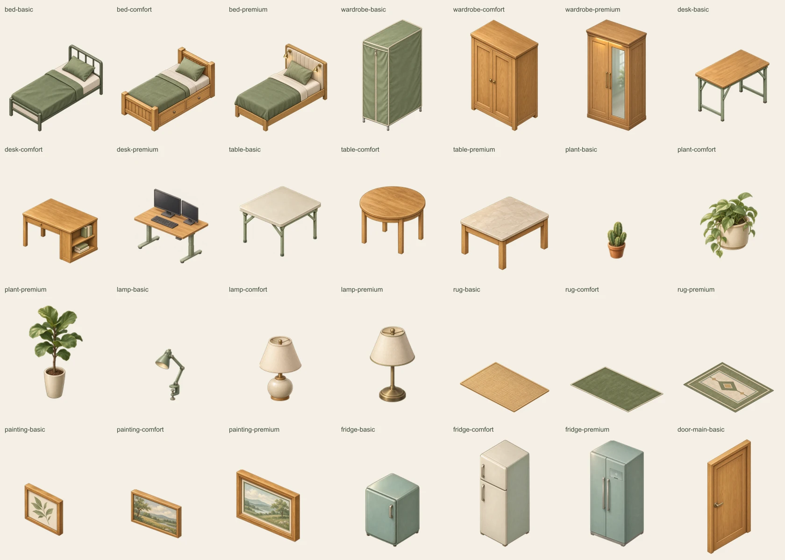
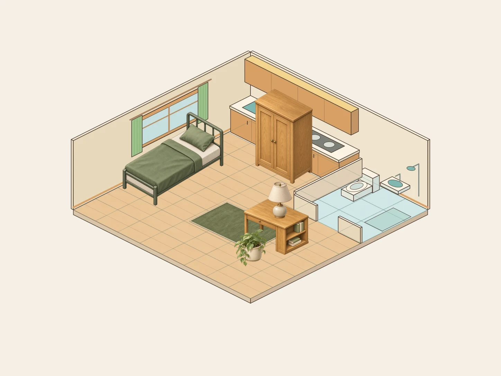

# Issue #133 — Lô 1: nội thất bán hiện thực

Phạm vi: 28 mẫu × 4 hướng (112 PNG), dùng ảnh chuẩn duy nhất `assets/style-reference/room-reference.webp`. Mẫu và quy cách lấy từ issue #133; không dùng ảnh ngoài. Các hướng xoay dùng thêm ảnh hướng a vừa tạo của chính mẫu đó để giữ thiết kế.

## Tài nguyên

- 27 mẫu: bed, wardrobe, desk, table, plant, lamp, rug, painting, fridge; mỗi loại basic, comfort, premium.
- Một mẫu cửa: door-main-basic.
- Tệp dùng trong game: `app/public/assets/furniture/<id>_<a|b|c|d>.png`.
- `manifest.json`: khung, neo, chân đế, dung lượng, SHA-256 và thông số xuất thực tế của từng ảnh.
- `prompts.json`: nguyên văn prompt từng ảnh, công cụ tạo và ảnh chuẩn.
- `contact-sheet.webp`: đủ mọi mẫu và bốn hướng, hai mẫu trên mỗi hàng.
- `models-a.webp`: tổng quan 28 mẫu hướng a. `directions-1.webp` đến `directions-4.webp` chia ảnh ghép bốn hướng thành các trang dễ phóng to.
- `room-grid-preview.webp`: đặt giường, bàn, tủ, thảm, cây và đèn trên vỏ phòng hiện tại, kèm lưới 8×8; vỏ phòng chưa được sửa (thuộc lô 5).
- `mobile-380.webp`: cùng cảnh ở chiều rộng 380 px để duyệt độ rõ.
- `mobile-390x844.png`: ảnh chụp trang duyệt asset trong Edge headless ở đúng viewport điện thoại 390×844; không phải ảnh chơi thử giao diện game.

## Quy cách và nguồn thông số

Giữ nguyên w, h, ax, ay, fw, fh từ `app/src/domain/furniture-sprites.json`. Các hướng c/d của tranh chưa có trong JSON hiện tại: dùng cùng thông số a/b tương ứng, đúng yêu cầu bốn hướng của issue. Cửa chính lấy khung và neo từ `assets/storybook-lot5/manifest.json`, đối chiếu PNG hiện có. Không tự sửa JSON runtime.

Tủ lạnh nộp PNG đúng tên yêu cầu. JSON runtime vẫn trỏ SVG; Claude sẽ chuyển tham chiếu và bỏ SVG sau khi duyệt theo issue. Không xóa SVG trước khi code được cập nhật. Tranh c/d được giao dưới dạng asset để Claude nối khi tích hợp.

Ảnh tạo bằng **built-in image_gen**, một lần gọi riêng cho mỗi sprite/hướng. Nền alpha do công cụ tạo ảnh cung cấp; không chroma-key, không thay thế bằng SVG hoặc hình vẽ thủ tục, không dùng lật ảnh để tạo hướng. Ánh sáng yêu cầu từ trên-trái, không bóng đổ ngoài chân đế, không chữ/logo.

`export.cjs` chỉ cắt lề alpha, thu nhỏ đồng tỉ lệ và nén PNG. Chiều ngang và cao độ đáy được hiệu chỉnh theo sprite tại commit `5649d3d` và manifest cũ; giữ nguyên neo khung, kể cả khi vật nằm bên trong chân đế và không chạm đáy canvas. Cửa/tranh giữ vùng treo gốc. Bàn nhựa và bàn tròn dùng vùng chuẩn a cho cả bốn góc để giữ cùng kích thước; cây và đèn giữ cùng chiều cao giữa các hướng. Cây trầu bà và bàng dùng vùng ảnh lớn hơn trong cùng khung để hợp tỉ lệ ảnh chuẩn; tủ lạnh mini thấp hơn mẫu hai cửa. Không bóp méo phối cảnh hoặc vẽ lại chất liệu. Kích thước và neo kiểm được bằng máy; vị trí từng chân, góc nhìn, chi tiết giữa các hướng và phong cách phải duyệt bằng ảnh ghép/cảnh đặt thử. Không đồng nhất việc giữ metadata với chứng nhận hình học từng pixel.

## Tái xuất và kiểm tra

Cần Node 24 và Sharp 0.35.5. Đặt `NODE_PATH` tới thư mục chứa Sharp, hoặc `ISSUE133_SHARP` tới module Sharp. `prepare.cjs` tạo lại tập prompt từ dữ liệu gốc. `sources.local.json` là ánh xạ key tới ảnh gốc tạo trong máy (không commit đường dẫn cá nhân); SHA-256 ảnh gốc nằm trong manifest.

```sh
node assets/issue-133-lot-1/prepare.cjs
node assets/issue-133-lot-1/export.cjs
node assets/issue-133-lot-1/verify.cjs
```

`mobile-preview.cjs` chụp trang duyệt bằng Playwright và Microsoft Edge; đặt `NODE_PATH` tới Playwright hoặc `ISSUE133_PLAYWRIGHT` tới module. Trên Windows sandbox có thể cần chạy Edge headless ngoài sandbox. Trang duyệt chỉ dùng ảnh nhúng local, không đọc save hoặc sửa game.

Chỉ chạy export khi có source map tương ứng. Verify đọc PNG thực tế, kiểm đủ 112 ảnh/28 mẫu/4 hướng, kích thước, alpha, hash, neo/chân đế so với dữ liệu gốc và giới hạn dưới 150.000 byte.

Lô 1 thuộc #133; không đóng toàn bộ issue khi gộp riêng lô này. Claude duyệt lô 1 trước khi bắt đầu lô 5. Không sửa TypeScript, core, save, bản đồ hoặc vỏ phòng trong PR này.

## Xem ảnh duyệt





[Tất cả 112 ảnh](contact-sheet.webp) · [Hướng 1](directions-1.webp) · [Hướng 2](directions-2.webp) · [Hướng 3](directions-3.webp) · [Hướng 4](directions-4.webp) · [Điện thoại 390×844](mobile-390x844.png)

## Kết quả kiểm tra

Kiểm tra trên main `5161099` sau khi rebase, ngày 04/11/2026; số liệu đầy đủ trong [validation.json](validation.json).

| Kiểm tra | Kết quả |
|---|---|
| `node assets/issue-133-lot-1/verify.cjs` | PASS, 112 PNG, lớn nhất 93.218 byte |
| `cd app && npm test` | PASS |
| `cd app && npm run build` | PASS; còn cảnh báo CSS public và kích thước chunk hiện có |
| `cd core && npm run check` | PASS, 18 tests |
| Xem bốn trang góc xoay, cảnh phòng và ảnh điện thoại | Đã kiểm tra; chờ Claude duyệt phong cách/độ khớp ô |
