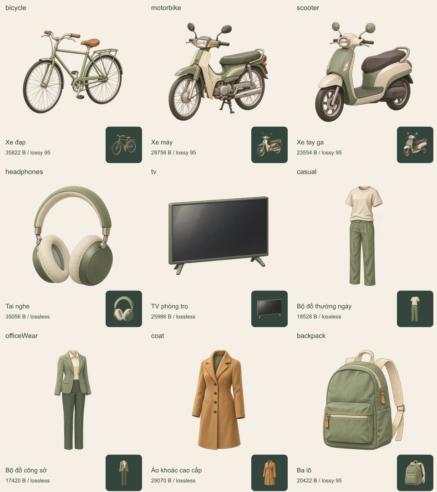

# Issue #133 — Lô 2: đồ trung tâm thương mại

Chín ảnh thẻ hàng theo phong cách bán hiện thực của `assets/style-reference/room-reference.webp`: tám mẫu trong mô tả issue và ba lô bổ sung tại [bình luận này](https://github.com/xsdaigiasx/lifesimu/issues/133#issuecomment-6635272274).

## Tệp giao

Tất cả đặt tại `app/public/assets/products/<id>.webp`, khung **256×256**, nền trong suốt, mỗi ảnh **dưới 40.000 byte**.

| ID | Mẫu |
|---|---|
| `bicycle` | Xe đạp |
| `motorbike` | Xe máy |
| `scooter` | Xe tay ga |
| `headphones` | Tai nghe |
| `tv` | TV phòng trọ |
| `casual` | Bộ đồ thường ngày |
| `officeWear` | Bộ đồ công sở |
| `coat` | Áo khoác cao cấp |
| `backpack` | Ba lô |

Ảnh là thẻ sản phẩm, nhìn gần chính diện hơi chéo; không có chân đế ô sàn hoặc tọa độ z. Manifest dùng `footprint_tiles: null`, khung 256×256 và neo tâm `[128,128]`. Giữ đúng chữ hoa/thường của ID `officeWear`.

## Phong cách và nguồn

Tạo bằng **built-in image_gen**, mỗi mẫu một lần gọi riêng, dùng duy nhất ảnh chuẩn của dự án làm đầu vào phong cách. Tô khối mềm, vật liệu vải/gỗ/kim loại tự nhiên, viền mảnh cùng tông, ánh sáng trên-trái; bảng màu sage, kem, xanh ngọc nhạt và nâu mật ong. Không chữ, logo, nhân vật hoặc bóng đổ ngoài vật. Xe máy và xe tay ga có thân xe khác nhau; quần áo hiển thị như bộ đồ trên form vô hình, không vẽ người hoặc mannequin.

`prompts.json` lưu nguyên văn prompt từng mẫu. `manifest.json` ghi kích thước, neo, hướng nhìn, vùng alpha, dung lượng, cách nén và SHA-256 nguồn/ảnh cuối. `sources.local.json` chỉ chứa đường dẫn ảnh gốc trên máy, được bỏ qua bởi Git.

`export.cjs` chỉ cắt lề alpha, thu nhỏ đồng tỉ lệ vào vùng tối đa 220×220, căn giữa và nén WebP; không vẽ lại nội dung. Ưu tiên lossless; nếu vượt giới hạn thì giảm chất lượng RGB từ 95, giữ `alphaQuality: 100`. Thông số nén thực tế ghi riêng cho từng ảnh.

## Ảnh duyệt



[Ảnh điện thoại 390×844](mobile-390x844.png). Đây là trang duyệt asset, không phải ảnh chơi thử giao diện game.

## Tái xuất và kiểm tra

Cần Node 24, Sharp 0.35.5; đặt `NODE_PATH` tới thư mục chứa module hoặc `ISSUE133_SHARP` tới Sharp. Chạy export khi có đủ ánh xạ nguồn local.

```sh
node assets/issue-133-lot-2/export.cjs
node assets/issue-133-lot-2/verify.cjs
```

Verify giải mã từng WebP, kiểm đủ chín ID, khung, alpha sạch ở lề, tâm hình, hash và giới hạn dung lượng. `mobile-preview.cjs` dùng Playwright + Microsoft Edge headless để chụp viewport 390×844; đặt `NODE_PATH` hoặc `ISSUE133_PLAYWRIGHT` tương ứng.

## Nối ảnh ba lô

`app/src/components/NpcFace.tsx` hiện có nhánh `backpack` trỏ tới `/icons/icon-192.png`. Claude cần chuyển nhánh này sang `/assets/products/backpack.webp` khi tích hợp ảnh đã duyệt. Tám mẫu cũ thay trực tiếp ở cùng tên tệp. PR lô 2 chỉ giao asset và tệp authoring/duyệt; không sửa TypeScript hoặc logic game.

Lô này thuộc #133 và không đóng toàn bộ issue. Kết quả kiểm tra được ghi trong `validation.json`.

## Kết quả kiểm tra

Ngày 05/11/2026, app đã kiểm tra lại trên main `164f344` sau rebase.

| Kiểm tra | Kết quả |
|---|---|
| `node assets/issue-133-lot-2/verify.cjs` | PASS, 9 WebP; lớn nhất 35.822 byte; tổng 235.614 byte |
| Nén ảnh | 5 lossless, 4 quality 95; alpha quality 100 |
| `cd app && npm test` | PASS |
| `cd app && npm run build` | PASS; còn cảnh báo CSS public và kích thước chunk hiện có |
| `cd core && npm run check` | PASS, 18 tests; core không đổi khi rebase |
| Xem ảnh ghép 256/64 px và chụp 390×844 | Đã kiểm tra; cả 9 ảnh giải mã được, không tràn trang |
