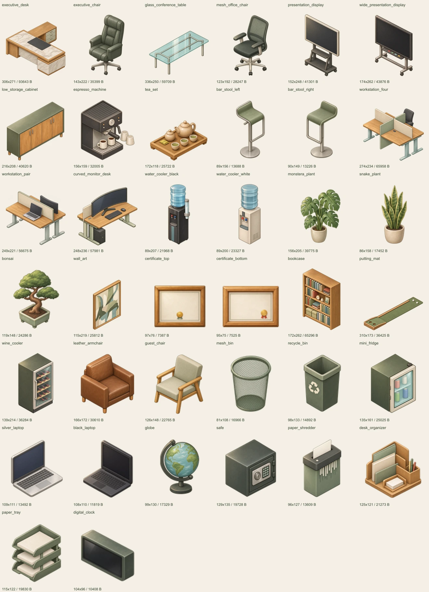

# Issue #133 — Lô 3: 38 sprite đồ văn phòng

Vẽ lại đúng 38 tệp trong `app/public/assets/offices/small/sprites/` theo phong cách bán hiện thực của `assets/style-reference/room-reference.webp`.

## Phạm vi giao

Giao **một bộ canonical small**. Theo issue, Claude sao chép bộ đã duyệt sang medium và large; hai thư mục đó được giữ nguyên trong PR. Không thay ảnh nền văn phòng, manifest runtime hoặc mã game. Bộ đồ văn phòng mới của #55 vẫn ngoài phạm vi lô này.

Giữ tên tệp, kích thước thật từng PNG và `anchor_point` theo manifest văn phòng. Các sprite này dùng hệ tọa độ pixel legacy, không có thông số chân đế ô sàn hoặc z; manifest bàn giao ghi `footprint_tiles: null`, `height_z: null` thay vì tự đặt số mới. `baseline.json` lưu khung, neo, vùng alpha gốc và hash của ba bộ trước khi sửa, tại commit `8aa6253`.

## Phong cách và nguồn

Tạo/chỉnh bằng **built-in image_gen**, mỗi sprite một lượt gọi riêng. Ảnh gốc của chính dự án là edit target để giữ thiết kế, bố cục, số bộ phận và góc nhìn; ảnh phòng chuẩn là tham chiếu phong cách duy nhất. Không dùng ảnh bên ngoài.

Tô khối mềm, vân gỗ/vải/kim loại tự nhiên, viền mảnh cùng tông; gỗ mật ong, sage, kem và xanh ngọc nhạt, ánh sáng trên-trái. Giữ khác biệt đen/trắng và bạc/đen của các thiết bị có tên tương ứng. Bỏ bóng đổ và quầng ngoài vật, chữ/nhãn/logo; màn hình tối, bằng khen dùng giấy trơn và dấu trang trí, đồng hồ không vẽ một giờ cố định.

`prompts.json` lưu nguyên văn prompt từng ảnh. `export.cjs` chỉ cắt lề alpha, thu nhỏ đồng tỉ lệ, đặt vào vùng ảnh gốc và nén PNG. Đồ sàn giữ đáy vùng ảnh; tranh và bằng khen giữ tâm vùng treo gốc. Không vẽ lại nội dung hoặc bóp méo ảnh bằng code. Nếu RGBA vượt 150.000 byte, script thử PNG palette; thông số nén thực tế ghi trong manifest.

## Ảnh duyệt



[Trang 1](page-1.webp) · [Trang 2](page-2.webp) · [Trang 3](page-3.webp) · [Bộ trước khi sửa](baseline-contact.webp) · [Điện thoại 390×844](mobile-390x844.png)

[Ảnh đặt thử theo neo](anchor-preview.webp) đặt sáu mẫu ở kích thước thật lên lưới chẩn đoán 128×64. Chấm nâu đánh dấu neo từ manifest; đây là ảnh minh họa kiểm tra, không phải bố trí đã lưu trong game và không thay vỏ phòng.

Ảnh điện thoại là trang duyệt chín mẫu tiêu biểu, không phải ảnh chơi thử game. Bản ghép tổng có đủ 38 mẫu để kiểm tra đồng bộ.

## Tái xuất và kiểm tra

Cần Node 24 và Sharp 0.35.5, qua `NODE_PATH` hoặc `ISSUE133_SHARP`. `sources.local.json` chứa đường dẫn các ảnh gốc được chọn trên máy và được Git bỏ qua; SHA-256 nguồn được ghi trong manifest.

```sh
node assets/issue-133-lot-3/export.cjs
node assets/issue-133-lot-3/verify.cjs
```

Verify kiểm đủ 38 ID, tên PNG, khung/neo so với manifest runtime, alpha/lề, hash và giới hạn 150.000 byte; đồng thời kiểm ba manifest runtime cùng ảnh medium/large vẫn giữ nguyên. Đây là kiểm tra phạm vi bàn giao trước bước Claude sao chép bộ ảnh.

`mobile-preview.cjs` dùng Playwright và Microsoft Edge headless; đặt module qua `NODE_PATH` hoặc `ISSUE133_PLAYWRIGHT` để chụp 390×844.

Kết quả kiểm tra ghi trong `validation.json`. Lô 3 thuộc #133, không đóng toàn bộ issue khi gộp riêng PR này.

## Kết quả kiểm tra

Đã kiểm tra app trên main `bc9ef16` sau rebase, ngày 05/11/2026.

| Kiểm tra | Kết quả |
|---|---|
| `node assets/issue-133-lot-3/verify.cjs` | PASS, 38 PNG; lớn nhất 93.643 byte |
| Tổng ảnh runtime | 1.151.333 byte; 38 PNG RGBA, không cần palette |
| Khung, neo và ba manifest runtime | Giữ nguyên |
| PNG medium/large | Giữ nguyên, chờ Claude sao chép bộ đã duyệt |
| `cd app && npm test` | PASS |
| `cd app && npm run build` | PASS; còn cảnh báo CSS public và kích thước chunk hiện có |
| `cd core && npm run check` | PASS, 18 tests |
| Xem đủ 38 ảnh, ảnh neo và bản 390×844 | Đã kiểm tra; chờ Claude duyệt mỹ thuật |
